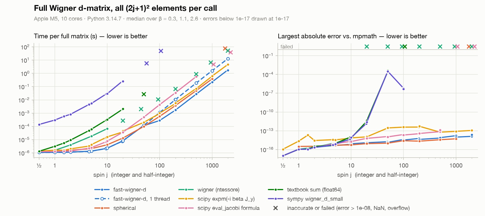

# fast-wigner-d

Wigner *d*- and *D*-matrices for integer and half-integer spin and any real angle. A small Cython
extension that can optionally be parallelised with OpenMP.

- Half-integer *j* is supported like integer *j*. Recursion-based libraries such as
  [`spherical`](https://github.com/moble/spherical) and [`wigner`](https://github.com/ntessore/wigner)
  support integer ℓ only.
- Elements are computed from Jacobi polynomials in log space, so large *j* neither overflows nor
  gives NaN. Absolute errors are about 10⁻¹⁴ up to *j* = 2000 (checked against mpmath).
- A small matrix takes about 1 µs, and *j* = 1000 (2001 × 2001) takes 0.2 s on 10 cores.
- Conventions of Varshalovich et al. ([below](#conventions)).

## Installation

```bash
pip install fast-wigner-d
```

Building from source requires a C compiler (pip installs Cython itself):

```bash
git clone <repository-url> fast-wigner-d
cd fast-wigner-d
pip install .
```

OpenMP is optional and detected at build time. Without it the results are the same, computed
serially. gcc (Linux) and MSVC (Windows) support it directly. Apple clang needs libomp:
`brew install libomp`, or `conda install -c conda-forge llvm-openmp` in a conda environment.

Build options (environment variables):

- `FAST_WIGNER_D_OPENMP=0` disables OpenMP, and `=1` requires it.
- `LIBOMP_PREFIX` sets a non-standard libomp location (macOS).
- `FAST_WIGNER_D_NATIVE=1` adds `-march=native` (local builds only).

To check a build:

```bash
python -c "import fast_wigner_d as f; print(f.__version__, f.OPENMP_ENABLED)"
```

## Usage

```python
import numpy as np
from fast_wigner_d import wigner_d, wigner_D

d = wigner_d(3/2, 0.7)      
d[3, 2]                     

wigner_d(1000.5, 2.0)                          
wigner_d(1, np.linspace(0, np.pi, 50)).shape   
wigner_D(1/2, 0.3, 1.2, -0.4)                  
wigner_d(500, 1.0, num_threads=1)              
```

`j` can be an `int`, a `float` (`2.5`) or a `fractions.Fraction`. Rows and columns run over
m = −j, …, j, so d<sup>j</sup><sub>m′m</sub> is `d[int(m' + j), int(m + j)]`. More examples in
[`examples/example_usage.ipynb`](examples/example_usage.ipynb).

## Conventions

D. A. Varshalovich, A. N. Moskalev and V. K. Khersonskii, *Quantum Theory of Angular Momentum*
(World Scientific, 1988), Ch. 4: active right-handed rotations, z-y-z Euler angles,
Condon–Shortley phases.

```text
D^j_{m'm}(α, β, γ) = <j m'| exp(-iα J_z) exp(-iβ J_y) exp(-iγ J_z) |j m>
                   = exp(-i m' α) d^j_{m'm}(β) exp(-i m γ)

d^{1/2}(β) = [[ cos(β/2), sin(β/2)],      d^1_{10}(β) = -sin(β)/√2
              [-sin(β/2), cos(β/2)]]      d^1_{01}(β) = +sin(β)/√2
(rows and columns m = -1/2, +1/2)
```

Identities:
d<sup>j</sup><sub>m′m</sub>(β) = (−1)<sup>m′−m</sup> d<sup>j</sup><sub>mm′</sub>(β) = d<sup>j</sup><sub>−m,−m′</sub>(β),
d(−β) = d(β)ᵀ, d(β + 2π) = (−1)<sup>2j</sup> d(β).

## Benchmarks

<picture>
  <source media="(prefers-color-scheme: dark)" srcset="benchmarks/results/benchmark-dark.png">
  
</picture>

Each cell is *time · largest error* for a full (2j+1) × (2j+1) matrix. Times are medians over
β = 0.3, 1.1, 2.6, excluding one-off setup (`spherical`'s object and numba compilation, `expm`'s
generator, `eval_jacobi`'s prefactors). Errors are absolute, against mpmath, and **bold** means
above 10⁻⁸ or NaN. Apple M5 (10 cores), macOS 26.6, Python 3.14.7, NumPy 2.5.4 (Accelerate), SciPy 1.18.1,
spherical 1.1.4, wigner 2025.1, sympy 1.14.0. fast-wigner-d uses all cores unless marked
"1 thread". The others are single-threaded except `expm` (BLAS).

| j | fast-wigner-d | fast-wigner-d<br>1 thread | spherical | wigner | scipy expm | scipy<br>eval_jacobi | textbook<br>sum | sympy |
|---:|---|---|---|---|---|---|---|---|
| 1 | 1.1 µs · 1e-16 | 1.1 µs · 1e-16 | 1.4 µs · 3e-16 | 1.6 µs · 1e-16 | 1.6 µs · 2e-15 | 1.3 µs · 1e-16 | 3.2 µs · 1e-16 | 301 µs · 1e-16 |
| 5 | 1.4 µs · 4e-16 | 1.4 µs · 4e-16 | 2.1 µs · 5e-16 | 18 µs · 1e-15 | 4.3 µs · 3e-15 | 2.5 µs · 9e-16 | 62 µs · 9e-16 | 5.42 ms · 8e-16 |
| 10 | 2.3 µs · 8e-16 | 2.3 µs · 8e-16 | 4.1 µs · 6e-16 | 68 µs · 4e-15 | 16 µs · 7e-15 | 7.8 µs · 2e-15 | 336 µs · 7e-15 | 29.4 ms · 8e-15 |
| 50 | 114 µs · 1e-15 | 121 µs · 1e-15 | 100 µs · 1e-15 | 2 ms · **NaN** | 204 µs · 3e-13 | 502 µs · 1e-14 | 27.4 ms · **4e-04** | 5.67 s · **3e-04** |
| 100 | 279 µs · 3e-15 | 1.11 ms · 3e-15 | 574 µs · 3e-15 | 10.7 ms · **NaN** | 1.02 ms · 4e-13 | 4.39 ms · 2e-14 | overflow | 48 s · **5e-07** |
| 200 | 1.71 ms · 4e-15 | 10.6 ms · 4e-15 | 3.76 ms · 2e-15 | 66.7 ms · **NaN** | 5.83 ms · 5e-13 | 34.9 ms · 4e-14 | overflow | (too slow) |
| 500 | 27.7 ms · 8e-15 | 191 ms · 8e-15 | 51 ms · 4e-15 | 880 ms · **NaN** | 70.8 ms · 6e-14 | 580 ms · 1e-13 | overflow | (too slow) |
| 1000 | 225 ms · 1e-14 | 1.58 s · 1e-14 | 383 ms · 5e-15 | 6.54 s · **NaN** | 626 ms · 8e-14 | 4.7 s · **NaN** | overflow | (too slow) |
| 2000 | 1.76 s · 2e-14 | 12.9 s · 2e-14 | 76.5 s · **NaN** | 50.5 s · **NaN** | 4.79 s · 1e-13 | 38.1 s · **NaN** | overflow | (too slow) |

Half-integer spin (not supported by `spherical` or `wigner`):

| j | fast-wigner-d | fast-wigner-d<br>1 thread | scipy expm | scipy<br>eval_jacobi | textbook<br>sum | sympy |
|---:|---|---|---|---|---|---|
| 1/2 | 1.1 µs · 0 | 1.1 µs · 0 | 1.4 µs · 1e-16 | 1.3 µs · 0 | 1.3 µs · 0 | 140 µs · 0 |
| 3/2 | 1.1 µs · 1e-16 | 1.1 µs · 1e-16 | 1.6 µs · 2e-14 | 1.4 µs · 1e-16 | 5.6 µs · 1e-16 | 576 µs · 1e-16 |
| 9/2 | 1.3 µs · 4e-16 | 1.3 µs · 4e-16 | 3.3 µs · 4e-15 | 2.3 µs · 8e-16 | 49 µs · 4e-16 | 4.56 ms · 6e-16 |
| 19/2 | 2.2 µs · 7e-16 | 2.1 µs · 7e-16 | 15 µs · 6e-15 | 6.9 µs · 2e-15 | 294 µs · 9e-15 | 27.5 ms · 4e-15 |
| 99/2 | 114 µs · 2e-15 | 117 µs · 2e-15 | 199 µs · 3e-13 | 486 µs · 1e-14 | 26.7 ms · **2e-04** | 5.66 s · **3e-04** |
| 199/2 | 277 µs · 4e-15 | 1.1 ms · 4e-15 | 928 µs · 4e-13 | 4.32 ms · 3e-14 | overflow | 48.7 s · **6e-07** |
| 999/2 | 27.6 ms · 7e-15 | 191 ms · 7e-15 | 73.7 ms · 6e-14 | 579 ms · 7e-14 | overflow | (too slow) |
| 1999/2 | 224 ms · 2e-14 | 1.6 s · 2e-14 | 610 ms · 8e-14 | 4.72 s · **NaN** | overflow | (too slow) |
| 3999/2 | 1.82 s · 1e-14 | 12.9 s · 1e-14 | 4.7 s · 1e-13 | 38 s · **NaN** | overflow | (too slow) |

- *j* ≲ 10: fast-wigner-d is the fastest method tested (1–2 µs).
- Large integer ℓ: on 10 cores fast-wigner-d is 1.7–2.2× faster than `spherical`. Per core,
  `spherical` is 2–4× faster (O(1) work per element instead of an O(*j*) recurrence) and up to 2×
  more accurate. At ℓ = 2000 `spherical` returned NaN after 77 s, while fast-wigner-d took 1.8 s
  (error 2 × 10⁻¹⁴).
- Half-integer *j*: fast-wigner-d is the fastest method and at least as accurate as the others.
  `expm` is 1.3–3.3× slower and up to 100× less accurate. The other methods fail or lose accuracy
  by *j* ≈ 50 (textbook sum, sympy) or *j* ≈ 1000 (`eval_jacobi`).

To reproduce:

```bash
pip install ".[benchmark]"
python benchmarks/run_benchmarks.py     # ~15 min (--quick: 2j <= 200)
python benchmarks/plot_benchmarks.py
```

## API

| Function | Returns |
|---|---|
| `wigner_d(j, beta, *, num_threads=None)` | real (2j+1, 2j+1) array, or `beta.shape + (2j+1, 2j+1)` |
| `wigner_D(j, alpha, beta, gamma, *, num_threads=None)` | complex D-matrix (the angles broadcast) |
| `get_wigner_d_matrix_optimized(j_times_2, beta, num_threads=0)` | the compiled kernel, taking 2j |
| `OPENMP_ENABLED` | whether the build uses OpenMP |

`num_threads=None` (≤ 0 for the kernel) uses the OpenMP default: `OMP_NUM_THREADS`, or all cores.
Pass `num_threads=1` when you parallelise over angles yourself.

## Development

```bash
pip install -e ".[test]"    # re-run after editing the .pyx
pytest                      # ~180 tests against mpmath, ~20 s
```

`.github/workflows/wheels.yml` builds and tests wheels for Linux, macOS and Windows with
[cibuildwheel](https://cibuildwheel.pypa.io) (configured in `pyproject.toml`) and uploads them to
PyPI when a GitHub release is published.

## License

MIT, see [LICENSE](LICENSE).
